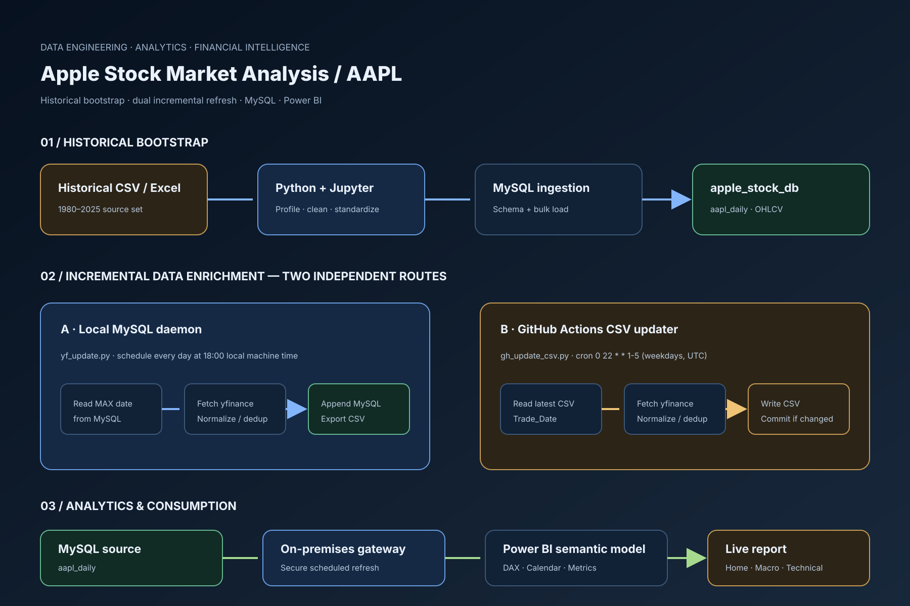

# AAPL Data Lineage & Refresh Architecture

This guide traces the project from the historical source files to the Power BI report and documents the two independent incremental refresh paths. The diagram is the source-aligned system map; the sections below explain each route.

[Open the SVG](../images/architecture_overview.svg) · [Open the PNG export](../images/architecture_overview.png)

## 1. Historical bootstrap

The initial dataset is stored under `data/raw/` as CSV and Excel source files. Jupyter notebooks profile and prepare the records, while `sql/01_data_ingestion.sql` creates the `apple_stock_db` schema and `aapl_daily` table and demonstrates the bulk-load step.

The primary market columns are the trade date, adjusted close, close, high, low, open, and volume.

## 2. Incremental refresh paths

### A. Local MySQL daemon

`scripts/yf_update.py` runs locally and uses the `schedule` package to call the update function every day at **18:00 local machine time**. It reads the latest `Trade_Date` from MySQL, requests subsequent AAPL observations from `yfinance`, normalizes the response, filters invalid and duplicate dates, appends new records to MySQL through SQLAlchemy, and exports the table to `data/processed/aapl_daily.csv`.

### B. GitHub Actions CSV updater

`/.github/workflows/data_update.yml` schedules `scripts/gh_update_csv.py` for **weekdays at 22:00 UTC** using `0 22 * * 1-5`. This route does not connect to MySQL. It reads the processed CSV in the repository, derives the next date from the latest `Trade_Date`, fetches later observations from `yfinance`, normalizes and deduplicates the rows, then writes the updated CSV. The workflow commits and pushes only when the file changed.

These are parallel update mechanisms with different destinations; the cloud updater does not write into the local MySQL database.

## 3. Storage and transformation

The MySQL `aapl_daily` table is the source used by the local relational analytics path. The SQL scripts cover initial loading, data-quality checks and the volume anomaly treatment, plus the CAGR and SMA-50/SMA-200 calculations.

The GitHub-hosted CSV is a separate versioned data artifact. It is maintained by the cloud updater and should not be described as a MySQL replica kept in sync by the same process.

## 4. Power BI consumption

The Power BI semantic model contains AAPL market data, S&P 500 benchmark data, a calendar table, technical metrics, and a dedicated DAX measure table. The documented MySQL route uses an on-premises data gateway to connect the local database to Power BI Service. The report includes three visible navigation pages — Home, Macro View, and Technical View — along with additional analytics and tooltip pages in the project structure.

[Open the live Power BI report](https://app.powerbi.com/view?r=eyJrIjoiNTNhYmI1ZjUtNDNhZC00OWM3LWFjYzktMmU0NWYyODYzZjIxIiwidCI6IjI1Y2UwMjYxLWJiZDYtNDljZC1hMWUyLTU0MjYwODg2ZDE1OSJ9) · [Dashboard design guide](powerbi_dashboard_design.md)

## 5. Traceability

| Layer | Main implementation | Output |
|---|---|---|
| Historical source | `data/raw/` | Initial AAPL history |
| Profiling and preparation | `notebooks/` | Validated, standardized data |
| MySQL ingestion and QA | `sql/` | `apple_stock_db.aapl_daily` |
| Local incremental refresh | `scripts/yf_update.py` | MySQL append + CSV export |
| Cloud CSV refresh | `scripts/gh_update_csv.py` + GitHub Actions | Versioned repository CSV |
| BI delivery | Power BI + on-premises gateway | Interactive report |

